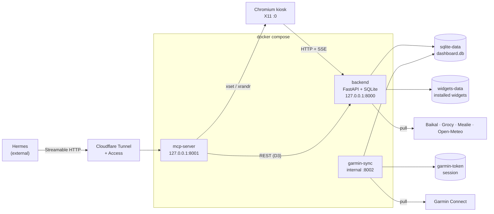

# worldplaner — Kiosk-Dashboard

[English](README.md) · **Deutsch**


Ein lokales, berührungsbedienbares **Kiosk-Dashboard** für ein einzelnes
Dell-Tablet mit Ubuntu Server. Es zeigt Wetter, Garmin-Gesundheitsdaten,
Hermes-To-Dos und Home-Automation-Daten (Baikal-Kalender, Grocy-Bestand,
Mealie-Wochenplan) im Vollbild (Querformat) und stellt dieselben Daten über
einen MCP-Server per Streamable HTTP für Hermes bereit.

Auf einen Blick:

- **9 Widgets**, pluginbasiert und in der Oberfläche umschaltbar.
- **3 Container** (`backend`, `mcp-server`, `garmin-sync`), gestartet über
  `docker compose`.
- **9 MCP-Werkzeuge**: Task-CRUD, Display-Steuerung und ein Garmin-Schreibtool.
- Eine SQLite-Datei (`dashboard.db`) als einzige Datenquelle.

## Was ist das?

`worldplaner` macht aus einem Tablet eine dauerhaft eingeschaltete
Informationsanzeige. Grundlage ist die build-reife Spezifikation `spec` Rev 2
(Abschnitte A–L) mit drei Regeln: **Stabilität vor Ästhetik**, **saubere
Widget-/Plugin-Architektur** („Shop"-Konzept) und **MCP ausschließlich über
HTTP/SSE** (kein stdio).

Auf dem Gerät läuft ein Chromium-Kiosk unter X11, der ein FastAPI-Backend lädt;
das Backend liefert Frontend und alle Widgets unter derselben Origin aus. Ein
eigener Container (`garmin-sync`) holt Garmin-Daten periodisch und ist der
**einzige** Schreiber des Garmin-Caches. Hermes läuft auf einem anderen Gerät und
erreicht das Dashboard nur über den MCP-Server, der per Cloudflare Tunnel mit
vorgeschaltetem Access exponiert wird. Die Installation am Gerät steht in
[`docs/setup.md`](docs/setup.md), die agentenseitige Installationsdatei in
[`AGENTS.md`](AGENTS.md).

## Funktionen & Widgets

Jedes Widget besteht aus einem Manifest und einem ES-Modul-Plugin; das Backend
seeded die eingebaute Registry beim Start aus `widgets/*/manifest.json`.

| Widget-ID | Beschreibung | Datenquelle (nur lesend) | Permission |
|---|---|---|---|
| `baikal-calendar` | Kommende Termine mit Titel und Startzeit (Ganztagstermine markiert). | `GET /api/baikal/events` | `baikal` |
| `grocy-stock` | Aktueller Bestand: Produkt, Menge, Einheit und nächstes MHD. | `GET /api/grocy/stock` | `grocy` |
| `mealie-mealplan` | Wochenplan: geplante Mahlzeiten je Tag mit Typ, Rezept und Portionen. | `GET /api/mealie/mealplan` | `mealie` |
| `weather` | Aktuelles Wetter: Temperatur, Zustand, Luftfeuchte und Wind. | `GET /api/weather/current` | `weather` |
| `garmin-sleep` | Letzte Nacht: Gesamtschlafdauer, Ein-/Aufwachzeit, Sleep-Score und Phasen. | `GET /api/garmin/sleep` | `garmin_cache` |
| `garmin-readiness` | Body Battery mit Tagesstreuung, Stress, Ruhepuls, Sleep-Score. | `GET /api/garmin/readiness` | `garmin_cache` |
| `garmin-workout` | Letzte Aktivitäten: Anzahl der letzten 7 Tage plus Typ, Dauer, Distanz, Kalorien, Puls. | `GET /api/garmin/workouts` | `garmin_cache` |
| `garmin-vitals` | Tageswerte: Schritte, Ruhepuls, Stress, Body Battery, Etagen, aktive Kalorien. | `GET /api/garmin/vitals` | `garmin_cache` |
| `hermes-todos` | Hermes-To-Do-Liste: Anzeige, Abhaken, Live-Aktualisierung per SSE. | `GET /api/tasks` | `tasks` |

Verhaltensvertrag der Widgets: `render()` baut nur das DOM auf, `refresh()` ist
der einzige Netzwerkaufruf, `onConfigChange()` übernimmt eine geänderte
Konfiguration und `destroy()` gibt Timer frei. Eine nicht erreichbare Quelle
stürzt den Host nie ab — das Widget zeigt den zuletzt bekannten Wert oder einen
leeren Zustand samt Fehlermarkierung.

## Architektur



Zentrale Invarianten:

- Das **Backend** ist der einzige Prozess, der Frontend (`/`) und Widgets
  (`/widgets/<id>/…`) ausliefert; Ports binden nur auf `127.0.0.1`.
- **`garmin-sync`** ist der einzige Schreiber der Tabelle `garmin_cache`;
  Backend und MCP-Server schreiben sie nie direkt.
- Der **MCP-Server** delegiert jedes Task-CRUD an die Backend-REST-API und
  berührt SQLite selbst nie.
- Ein **Cloudflare Tunnel** exponiert ausschließlich den MCP-Server
  (`127.0.0.1:8001`), hinter Cloudflare Access mit Service Token. Das Frontend
  bleibt lokal.

### HTTP-API

Alle Antworten sind JSON; Fehler haben eine einheitliche Form:
`{"error":{"code":"…","message":"…","retryable":false}}`.

| Methode | Pfad | Zweck |
|---|---|---|
| GET | `/api/health` | Health + DB-Status |
| GET | `/api/config` | Grid-Konfiguration, Tabs, aktiver Tab |
| GET | `/api/widgets` | Installierte Widgets |
| POST | `/api/widgets/install` | Widget aus Zip-Upload installieren |
| POST | `/api/widgets/install/git` | Widget aus Git-URL installieren (`ref`, Default `main`) |
| GET | `/api/widgets/{id}` | Manifest + Config |
| PATCH | `/api/widgets/{id}` | `is_enabled` / `config` ändern |
| DELETE | `/api/widgets/{id}` | Installiertes (nicht eingebautes) Widget deinstallieren |
| GET | `/api/layout?tab=` | Bento-Instanzen |
| POST/PUT/DELETE | `/api/layout[/{id}]` | Layout-Instanz anlegen/ändern/löschen |
| GET/POST | `/api/tasks` | Hermes-To-Dos lesen/anlegen |
| PATCH/DELETE | `/api/tasks/{id}` | To-Do ändern/löschen |
| GET | `/api/baikal/events` | Kalendertermine (gecacht) |
| GET | `/api/grocy/stock` | Grocy-Bestand (gecacht) |
| GET | `/api/mealie/mealplan` | Mealie-Wochenplan (gecacht) |
| GET | `/api/garmin/{sleep,readiness,workouts,vitals}` | Garmin-Cache (nur lesend) |
| POST | `/api/garmin/workouts` | Garmin-Aktivität nachtragen |
| GET | `/api/weather/{current,forecast}` | Wetter (Open-Meteo, gecacht) |
| GET/PUT | `/api/state/{key}` | Dashboard-Zustand |
| GET | `/api/events` | SSE-Ereignisstrom |

## Voraussetzungen

- **Docker Engine** mit **Compose v2** (startet den Stack).
- **Python ≥ 3.12** — nur zum Ausführen der Tests außerhalb von Docker.
- **Node.js** — nur für die Frontend-Unit- und E2E-Tests.
- **Tablet-Host**: Ubuntu 22.04/24.04 LTS, X11, Chromium, systemd und
  `cloudflared` für den MCP-Tunnel.

## Quickstart

```bash
cp .env.example .env          # optional: ohne .env gelten die Defaults
docker compose up -d --build
curl -s http://localhost:8000/api/health   # -> {"status":"ok","db":"ok"}
curl -sf http://localhost:8001/healthz     # -> MCP-Server gesund
```

Danach `http://localhost:8000` im Browser öffnen.

Beim Start legt das Backend das SQLite-Schema idempotent an, seedet die drei
Tabs (`dashboard`, `todos`, `widgets`), registriert die eingebauten Widgets aus
`widgets/*/manifest.json` (Upsert per `id`, `is_builtin=1`) und leitet aus ihren
`default_size`-Angaben ein initiales `dashboard_layout` ab. Die SQLite-Datei
liegt im Volume `sqlite-data` unter `/data/dashboard.db`; der Widget-Ordner lässt
sich per `WIDGETS_DIR` überschreiben.

## Konfiguration

Alles wird über Umgebungsvariablen konfiguriert; `.env.example` ist die Vorlage.
Geheimnisse gehören nie ins Repo — `.env` ist git-ignoriert.

| Variable | Default | Zweck |
|---|---|---|
| `BACKEND_PORT` | `8000` | Host-Port des Backends (`127.0.0.1`). |
| `SQLITE_PATH` | `/data/dashboard.db` | SQLite-Datei im Backend-Container. |
| `MCP_PORT` | `8001` | Host-Port des MCP-Servers (`127.0.0.1`). |
| `DISPLAY` | `:0` | X11-Display für die MCP-Display-Werkzeuge. |
| `DISPLAY_OUTPUT` | `eDP-1` | X11-Ausgabe für die Helligkeitssteuerung. |
| `MCP_RATE_LIMIT_PER_MINUTE` | `60` | Token-Bucket-Limit pro Identität (`0` deaktiviert). |
| `CF_ACCESS_TEAM_DOMAIN` | — | Cloudflare-Access-Team-Domain zur JWT-Prüfung. |
| `CF_ACCESS_AUD` | — | Cloudflare-Access-Audience-Tag. |
| `GARMIN_EMAIL` | — | Garmin-Konto (E-Mail). |
| `GARMIN_PASSWORD` | — | Garmin-Konto (Passwort). |
| `GARMIN_SYNC_INTERVAL_SECONDS` | `1200` | Abrufintervall. |
| `GARMIN_BACKOFF_BASE_SECONDS` | `60` | Backoff-Basis bei Netz-/5xx-Fehlern. |
| `GARMIN_BACKOFF_MAX_ATTEMPTS` | `5` | Maximale Backoff-Versuche. |
| `GARMIN_BACKOFF_CAP_SECONDS` | `3600` | Obergrenze der Backoff-Wartezeit. |
| `GARMIN_TOKEN_DIR` | `/data/token` | Persistente Garmin-Session (Volume `garmin-token`). |
| `GARMIN_SYNC_MOCK` | `0` | `1` schreibt synthetische Cache-Zeilen (Verifikation ohne Konto). |
| `WEATHER_LATITUDE` | `48.1374` | Standort-Breitengrad (Open-Meteo). |
| `WEATHER_LONGITUDE` | `11.5755` | Standort-Längengrad. |
| `WEATHER_TIMEZONE` | `Europe/Berlin` | Zeitzone der Wetterabfrage. |
| `WEATHER_CACHE_TTL_SECONDS` | `600` | Cache-TTL Wetter. |
| `BAIKAL_URL` | — | Baikal-Caldav-Endpunkt (HTTP Basic). |
| `BAIKAL_USERNAME` / `BAIKAL_PASSWORD` | — | Baikal-Zugangsdaten. |
| `BAIKAL_CACHE_TTL_SECONDS` | `600` | Cache-TTL Kalender. |
| `BAIKAL_DAYS_AHEAD` | `7` | Vorausschau in Tagen. |
| `BAIKAL_TIMEOUT_SECONDS` | `10` | Request-Timeout. |
| `GROCY_URL` | — | Grocy-Basis-URL (Grocy ≥ 3.3). |
| `GROCY_API_KEY` | — | Grocy-API-Schlüssel. |
| `GROCY_CACHE_TTL_SECONDS` | `600` | Cache-TTL Bestand. |
| `GROCY_TIMEOUT_SECONDS` | `10` | Request-Timeout. |
| `MEALIE_URL` | — | Mealie-Basis-URL (v2). |
| `MEALIE_API_TOKEN` | — | Mealie-Bearer-Token. |
| `MEALIE_CACHE_TTL_SECONDS` | `600` | Cache-TTL Wochenplan. |
| `MEALIE_DAYS_AHEAD` | `7` | Vorausschau in Tagen. |
| `MEALIE_TIMEOUT_SECONDS` | `10` | Request-Timeout. |
| `WIDGETS_INSTALL_DIR` | `/data/widgets` | Schreib-Volume für installierte Widgets. |
| `WIDGETS_MAX_ZIP_BYTES` | `10485760` | Maximale Zip-Uploadgröße (10 MiB). |
| `WIDGETS_MAX_UNCOMPRESSED_BYTES` | `52428800` | Maximale entpackte Größe (50 MiB). |
| `GRID_COLUMNS` | `12` | Spalten des Bento-Grids. |
| `GRID_ROW_HEIGHT_PX` | `96` | Zeilenhöhe des Bento-Grids. |
| `GRID_GAP_PX` | `8` | Abstand im Bento-Grid. |

Der MCP-Server akzeptiert zusätzlich `MCP_AUTH_MODE` (`auto` — prüfen, sobald
Access konfiguriert ist, Default; `enforce` — fehlende Konfiguration ist ein
Startfehler; `edge` — vollständig an den Edge delegieren) sowie
`MCP_ALLOWED_HOSTS` und `MCP_ALLOWED_ORIGINS` für die DNS-Rebinding-Allowlist.

## Installation auf dem Tablet (Kiosk / X11 / Chromium / systemd)

Die Geräteeinrichtung ist eine Checkliste; die direkt kopierbare,
schrittweise Fassung steht in [`docs/setup.md`](docs/setup.md). Zusammenfassung:

1. **Repo unter `/opt/worldplaner` ablegen** — die systemd-Units und die
   Tunnel-Konfiguration verweisen auf diesen Pfad:

   ```bash
   sudo mkdir -p /opt/worldplaner
   sudo chown "$USER":"$USER" /opt/worldplaner
   git clone https://github.com/marexxxxxxx/worldplaner /opt/worldplaner
   cd /opt/worldplaner && cp .env.example .env && $EDITOR .env
   chmod +x deploy/scripts/screen-*.sh
   ```

2. **Host-Pakete installieren** (X11 + Display-Werkzeuge, Chromium, Docker,
   cloudflared):

   ```bash
   sudo apt-get update
   sudo apt-get install -y xserver-xorg xinit x11-xserver-utils \
     chromium-browser docker.io docker-compose-v2 cloudflared
   ```

3. **Kiosk-Benutzer anlegen und Docker aktivieren**:

   ```bash
   sudo useradd -m -s /bin/bash kiosk
   sudo usermod -aG video,audio,input,render kiosk
   sudo systemctl enable --now docker.service
   ```

4. **systemd-Units installieren und Stack starten** (die Units liegen in
   `deploy/systemd/` und führen `docker compose up -d` aus `/opt/worldplaner`
   aus):

   ```bash
   sudo cp /opt/worldplaner/deploy/systemd/*.service /etc/systemd/system/
   sudo cp /opt/worldplaner/deploy/systemd/*.timer   /etc/systemd/system/
   sudo systemctl daemon-reload
   sudo systemctl enable --now docker-compose.service
   sudo systemctl enable --now kiosk-x11.service kiosk-chromium.service
   sudo systemctl enable --now kiosk-chromium-restart.timer
   ```

   `kiosk-x11.service` startet einen einzigen, dauerhaften Xorg auf `:0`,
   `kiosk-chromium.service` startet Chromium im Kiosk-Modus gegen
   `http://localhost:8000` mit `Restart=always`, und
   `kiosk-chromium-restart.timer` startet Chromium täglich um 04:00 neu.

5. **X11-Zugriff für den MCP-Container freigeben** (er läuft als root):

   ```bash
   DISPLAY=:0 xhost +local:root
   ```

6. **Tunnel und Access konfigurieren**, danach den einmaligen Garmin-MFA-Login
   ausführen (`docker compose run --rm garmin-sync …`, siehe MCP-Abschnitt und
   [`docs/setup.md`](docs/setup.md)).

## MCP-/Hermes-Anbindung

Der MCP-Server spricht **Streamable HTTP**. Einziger Endpunkt ist `POST /mcp`
(`GET /mcp` liefert den Stream), dazu `GET /healthz` für den Healthcheck. Im
Compose-Netz lauscht er auf Port `8001`; das Host-Mapping ist `127.0.0.1:8001`,
und der Cloudflare Tunnel exponiert genau diesen Port.

Sicherheits-Defaults (Spez. F.1):

- **Cloudflare Access**: Der Header `Cf-Access-Jwt-Assertion` wird gegen
  `CF_ACCESS_AUD` und `CF_ACCESS_TEAM_DOMAIN` geprüft (Modus `auto`).
- **DNS-Rebinding-Schutz** über eine explizite Host-/Origin-Allowlist.
- **Rate-Limit** von `MCP_RATE_LIMIT_PER_MINUTE` Anfragen pro Minute und
  Identität.

Jedes Werkzeug liefert `{ok:true, …}` oder
`{ok:false, error:{code,message,retryable}}` — niemals eine Exception.
Task-CRUD wird an die Backend-REST-API delegiert (D3); der MCP-Server schreibt
nie nach SQLite.

| Werkzeug | Art | Zweck |
|---|---|---|
| `dashboard_status` | read | Gesamtzustand: aktiver Tab, Bildschirm on/off, Helligkeit, Task-Zähler, Backend-Health. |
| `task_list` | read | Hermes-To-Dos auflisten (`status` `open`/`done`/`all`, max. 200). |
| `task_create` | write | To-Do anlegen (`source=hermes`). |
| `task_update` | write | Titel, Beschreibung, Status, Priorität oder Fälligkeit ändern (bedingungslos — „Hermes gewinnt"). |
| `task_delete` | write (destruktiv) | To-Do löschen; verlangt `confirm: true`, optional `expected_title`. |
| `screen_off` | write | Display ausschalten (`xset dpms force off`). |
| `screen_on` | write | Display einschalten und Helligkeit auf `1.0` setzen. |
| `screen_dim` | write | Display dimmen (`brightness` 0.0–1.0, Default `0.3`). |
| `garmin_add_workout` | write | Abgeschlossene Aktivität nachtragen: `activity_type`, `start_time` (ISO-8601 UTC), `duration_s`; optional `distance_m`, `calories`, `title`. |

Display-Werkzeuge liefern `DISPLAY_UNAVAILABLE`, wenn kein X11-Socket erreichbar
ist, statt abzustürzen; `garmin_add_workout` liefert `GARMIN_UNAVAILABLE`
(retryable) oder `GARMIN_AUTH_FAILED` (nicht retryable).

Hermes verbindet sich mit dem öffentlichen MCP-Hostnamen (zum Beispiel
`https://mcp.example.com/mcp`) und dem Cloudflare-Access-Service-Token, das auf
der Hermes-Seite liegt — nie in diesem Repository.

## Widget-Verwaltung & Shop

Der eingebaute Tab `widgets` ist die Admin-Oberfläche am Gerät:

- **Auflisten & Umschalten**: listet `GET /api/widgets` und schaltet
  `is_enabled` persistent über `PATCH /api/widgets/{id}` um; ein deaktiviertes
  Widget verschwindet aus dem `dashboard`-Tab.
- **Aus Zip installieren**: `.zip` über `POST /api/widgets/install` hochladen
  (Grenzen `WIDGETS_MAX_ZIP_BYTES` / `WIDGETS_MAX_UNCOMPRESSED_BYTES`).
- **Aus Git installieren**: `POST /api/widgets/install/git` mit Repository-URL
  und optionalem `ref` (Default `main`).
- **Deinstallieren**: `DELETE /api/widgets/{id}` — nur für installierte Widgets
  (`is_builtin=0`); eingebaute bleiben schreibgeschützt.

Ein hochgeladenes Widget wird in das Volume `widgets-data`
(`WIDGETS_INSTALL_DIR`) entpackt und unter `/widgets/<id>/…` ausgeliefert;
installierte Widgets haben Vorrang vor eingebauten. Jedes Widget bringt eine
`manifest.json` mit (`id`, `name`, `version`, `category`, `permissions`,
`config_schema`, `default_size`, `min_size`) — ein Beispiel steht in jeder
`widgets/<id>/README.md`.

**Serverseitiges Permission-Gate (E.4):** Anfragen mit Header `X-Widget-Id`
werden gegen das Manifest des Widgets geprüft — eine fehlende Permission ergibt
`403 FORBIDDEN`, ein unbekanntes Widget `404`. Anfragen ohne Header (App-Shell
oder MCP-Server) sind erlaubt. Dieselbe Zuordnung ist clientseitig in
`frontend/js/widget-runtime.js` gespiegelt.

## Tests

```bash
# Backend (FastAPI + SQLite)
cd backend && pip install -e ".[dev]" && pytest

# MCP-Server (Schemas, Middleware, Werkzeuge, Display)
cd mcp-server && pip install -e ".[dev]" && pytest

# garmin-sync (Payload-Schema, Backoff/Auth, No-Credentials-Pfad, Write-Endpunkt)
cd garmin-sync && pip install -e ".[dev]" && pytest

# Frontend-Unit-Tests (Bento-Grid-Engine, Widget-Logik)
cd frontend && npm install && npm test

# Frontend-E2E gegen den laufenden Stack (benötigt Chromium)
BASE_URL=http://127.0.0.1:8000 CHROMIUM_PATH=/path/to/chrome npm run test:e2e
BASE_URL=http://127.0.0.1:8000 CHROMIUM_PATH=/path/to/chrome npm run test:e2e:admin
```

## Troubleshooting

| Symptom | Ursache / Abhilfe |
|---|---|
| `screen_off/on/dim` liefern `DISPLAY_UNAVAILABLE` | Kein erreichbarer X11-Socket. Sicherstellen, dass `/tmp/.X11-unix` gemountet ist und `xhost +local:root` gelaufen ist; das Dashboard funktioniert auch ohne. |
| Garmin-Container loggt fehlende Credentials | `GARMIN_EMAIL` / `GARMIN_PASSWORD` setzen und den einmaligen MFA-Login ausführen (siehe [`docs/setup.md`](docs/setup.md)); der Container startet ohne Absturz. |
| `GET /api/health` ist nicht `{"status":"ok","db":"ok"}` | `docker compose logs backend` prüfen; Volume `sqlite-data` und `SQLITE_PATH` kontrollieren. |
| Widgets fehlen im Dashboard | Eingebaute werden beim Start geseedet; installierte liegen in `widgets-data`. Das Flag `is_enabled` und die Zip-Größengrenzen prüfen. |
| Port bereits belegt | `BACKEND_PORT` / `MCP_PORT` in `.env` ändern und den Stack neu starten. |
| MCP-Anfragen abgewiesen (`401`/`403`) | `CF_ACCESS_TEAM_DOMAIN`, `CF_ACCESS_AUD` und `MCP_AUTH_MODE` prüfen; das Access-Service-Token muss auf der Hermes-Seite konfiguriert sein. |
| Kiosk-Bildschirm bleibt nach dem Boot schwarz | `systemctl status kiosk-x11.service kiosk-chromium.service` prüfen; X-Server und Chromium starten beide automatisch neu. |

## Roadmap & Lizenz

**Fertig**

- Phase 1 (MVP): Docker Compose + SQLite-Schema, FastAPI-Backend, Widget-Runtime
  und Hermes-To-Do-Tab, Wetter-Widget, Garmin-Widgets
  Schlaf/Readiness/Workout/Vitalwerte, MCP-Server mit Task-CRUD und
  Display-Steuerung, Widget-Verwaltung.
- Phase 2: Baikal-/Grocy-/Mealie-Adapter (Kalender, Bestand, Wochenplan),
  Zip- und Git-basierte Widget-Installation, das Garmin-Schreibtool
  (`garmin_add_workout`) mit internem Write-Endpunkt auf `garmin-sync` und das
  serverseitige Permission-Gate (E.4).

**Offen / als Nächstes**

- Es ist noch keine Lizenz veröffentlicht — siehe unten.
- Weitere Widgets und Adapter lassen sich ohne Änderungen am Kern ergänzen.

**Lizenz:** Dieses Repository enthält derzeit **keine `LICENSE`-Datei**. Solange
keine hinzugefügt ist, sind alle Rechte vorbehalten und eine öffentliche
Weiterverbreitung ist nicht gestattet; vor einer Verbreitung eine Lizenz der
eigenen Wahl ergänzen.
