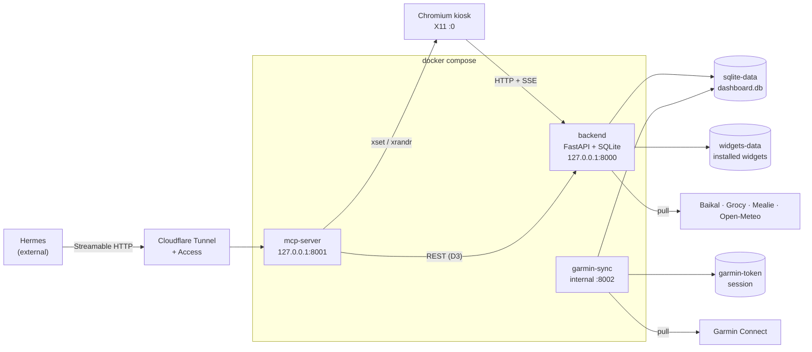

# worldplaner — Kiosk Dashboard

**English** · [Deutsch](README.de.md)


A local, touch-operated **kiosk dashboard** for a single Dell tablet running
Ubuntu Server. It shows weather, Garmin health data, Hermes to-dos and
home-automation data (Baikal calendar, Grocy stock, Mealie meal plan)
full-screen in landscape, and exposes the same data to Hermes through an
MCP server over Streamable HTTP.

At a glance:

- **9 widgets**, plugin-based and toggleable from the UI.
- **3 containers** (`backend`, `mcp-server`, `garmin-sync`) started by
  `docker compose`.
- **9 MCP tools**: task CRUD, display control and a Garmin write tool.
- One SQLite file (`dashboard.db`) as the single source of truth.

## What is this?

`worldplaner` turns a tablet into an always-on information panel. It is built
against the build-ready specification `spec` Rev 2 (sections A–L) and follows
three rules: **stability before aesthetics**, **a clean widget/plugin
architecture** (a "shop" concept), and **MCP over HTTP/SSE only** (no stdio).

The device runs a Chromium kiosk on X11 that loads a FastAPI backend serving the
frontend and all widgets from the same origin. A separate container
(`garmin-sync`) pulls Garmin data on a schedule and is the *only* writer of the
Garmin cache. Hermes runs on a different machine and reaches the dashboard only
through the MCP server, exposed via a Cloudflare Tunnel with Access in front of
it. See [`docs/setup.md`](docs/setup.md) for the on-device installation and
[`AGENTS.md`](AGENTS.md) for the agent-facing install notes.

## Features & widgets

Every widget is a manifest plus an ES-module plugin; the backend seeds the
built-in registry from `widgets/*/manifest.json` on startup.

| Widget ID | Description | Data source (read-only) | Permission |
|---|---|---|---|
| `baikal-calendar` | Upcoming appointments with title and start time (all-day marked). | `GET /api/baikal/events` | `baikal` |
| `grocy-stock` | Current stock: product, amount, unit and next best-before date. | `GET /api/grocy/stock` | `grocy` |
| `mealie-mealplan` | Meal plan: planned meals per day with type, recipe and portions. | `GET /api/mealie/mealplan` | `mealie` |
| `weather` | Current weather: temperature, condition, humidity and wind. | `GET /api/weather/current` | `weather` |
| `garmin-sleep` | Last night: total sleep, bed/wake time, sleep score and stages. | `GET /api/garmin/sleep` | `garmin_cache` |
| `garmin-readiness` | Body Battery with daily range, stress, resting heart rate, sleep score. | `GET /api/garmin/readiness` | `garmin_cache` |
| `garmin-workout` | Recent activities: count over the last 7 days plus type, duration, distance, calories, HR. | `GET /api/garmin/workouts` | `garmin_cache` |
| `garmin-vitals` | Daily values: steps, resting HR, stress, Body Battery, floors, active calories. | `GET /api/garmin/vitals` | `garmin_cache` |
| `hermes-todos` | Hermes to-do list: display, check off, live update via SSE. | `GET /api/tasks` | `tasks` |

Widget behavior contract: `render()` is DOM-only, `refresh()` is the only
network call, `onConfigChange()` applies a changed config and `destroy()`
releases timers. A failing source never crashes the host — the widget shows its
last known value or an empty state plus an error label.

## Architecture



Key invariants:

- The **backend** is the only process serving the frontend (`/`) and widgets
  (`/widgets/<id>/…`); ports bind to `127.0.0.1` only.
- **`garmin-sync`** is the single writer of the `garmin_cache` table; the backend
  and MCP server never write it directly.
- The **MCP server** delegates all task CRUD to the backend REST API and never
  touches SQLite itself.
- A **Cloudflare Tunnel** exposes only the MCP server (`127.0.0.1:8001`), behind
  Cloudflare Access with a service token. The frontend stays local.

### HTTP API

All responses are JSON; errors use one shape:
`{"error":{"code":"…","message":"…","retryable":false}}`.

| Method | Path | Purpose |
|---|---|---|
| GET | `/api/health` | Health + DB status |
| GET | `/api/config` | Grid config, tabs, active tab |
| GET | `/api/widgets` | Installed widgets |
| POST | `/api/widgets/install` | Install a widget from a ZIP upload |
| POST | `/api/widgets/install/git` | Install a widget from a Git URL (`ref`, default `main`) |
| GET | `/api/widgets/{id}` | Manifest + config |
| PATCH | `/api/widgets/{id}` | Change `is_enabled` / `config` |
| DELETE | `/api/widgets/{id}` | Uninstall an installed (non-built-in) widget |
| GET | `/api/layout?tab=` | Bento instances |
| POST/PUT/DELETE | `/api/layout[/{id}]` | Create/update/delete a layout instance |
| GET/POST | `/api/tasks` | Read/create Hermes to-dos |
| PATCH/DELETE | `/api/tasks/{id}` | Update/delete a to-do |
| GET | `/api/baikal/events` | Calendar events (cached) |
| GET | `/api/grocy/stock` | Grocy stock (cached) |
| GET | `/api/mealie/mealplan` | Mealie meal plan (cached) |
| GET | `/api/garmin/{sleep,readiness,workouts,vitals}` | Garmin cache (read-only) |
| POST | `/api/garmin/workouts` | Backfill a Garmin activity |
| GET | `/api/weather/{current,forecast}` | Weather (Open-Meteo, cached) |
| GET/PUT | `/api/state/{key}` | Dashboard state |
| GET | `/api/events` | SSE event stream |

## Requirements

- **Docker Engine** with the **Compose v2** plugin (runs the stack).
- **Python ≥ 3.12** — only to run the test suites outside Docker.
- **Node.js** — only for the frontend unit and E2E tests.
- **Tablet host**: Ubuntu 22.04/24.04 LTS, X11, Chromium, systemd, and
  `cloudflared` for the MCP tunnel.

## Quickstart

```bash
cp .env.example .env          # optional: without .env the defaults apply
docker compose up -d --build
curl -s http://localhost:8000/api/health   # -> {"status":"ok","db":"ok"}
curl -sf http://localhost:8001/healthz     # -> MCP server healthy
```

Open `http://localhost:8000` in a browser to see the dashboard.

On startup the backend idempotently creates the SQLite schema, seeds the three
tabs (`dashboard`, `todos`, `widgets`), registers the built-in widgets from
`widgets/*/manifest.json` (upsert by `id`, `is_builtin=1`) and derives an initial
`dashboard_layout` from their `default_size`. The SQLite file lives in the
`sqlite-data` volume at `/data/dashboard.db`; the widget source directory can be
overridden with `WIDGETS_DIR`.

## Configuration

Everything is configured through environment variables; `.env.example` is the
template. Secrets never belong in the repository — `.env` is git-ignored.

| Variable | Default | Purpose |
|---|---|---|
| `BACKEND_PORT` | `8000` | Host port for the backend (`127.0.0.1`). |
| `SQLITE_PATH` | `/data/dashboard.db` | SQLite file inside the backend container. |
| `MCP_PORT` | `8001` | Host port for the MCP server (`127.0.0.1`). |
| `DISPLAY` | `:0` | X11 display for the MCP display tools. |
| `DISPLAY_OUTPUT` | `eDP-1` | X11 output for brightness control. |
| `MCP_RATE_LIMIT_PER_MINUTE` | `60` | Token-bucket rate limit per identity (`0` disables). |
| `CF_ACCESS_TEAM_DOMAIN` | — | Cloudflare Access team domain for JWT verification. |
| `CF_ACCESS_AUD` | — | Cloudflare Access audience tag. |
| `GARMIN_EMAIL` | — | Garmin account e-mail. |
| `GARMIN_PASSWORD` | — | Garmin account password. |
| `GARMIN_SYNC_INTERVAL_SECONDS` | `1200` | Pull interval. |
| `GARMIN_BACKOFF_BASE_SECONDS` | `60` | Backoff base on network/5xx errors. |
| `GARMIN_BACKOFF_MAX_ATTEMPTS` | `5` | Max backoff attempts. |
| `GARMIN_BACKOFF_CAP_SECONDS` | `3600` | Upper bound for the backoff delay. |
| `GARMIN_TOKEN_DIR` | `/data/token` | Persistent Garmin session (volume `garmin-token`). |
| `GARMIN_SYNC_MOCK` | `0` | `1` writes synthetic cache rows (verification without an account). |
| `WEATHER_LATITUDE` | `48.1374` | Weather location latitude (Open-Meteo). |
| `WEATHER_LONGITUDE` | `11.5755` | Weather location longitude. |
| `WEATHER_TIMEZONE` | `Europe/Berlin` | Timezone for the weather query. |
| `WEATHER_CACHE_TTL_SECONDS` | `600` | Weather cache TTL. |
| `BAIKAL_URL` | — | Baikal CalDAV endpoint (HTTP Basic). |
| `BAIKAL_USERNAME` / `BAIKAL_PASSWORD` | — | Baikal credentials. |
| `BAIKAL_CACHE_TTL_SECONDS` | `600` | Calendar cache TTL. |
| `BAIKAL_DAYS_AHEAD` | `7` | Days shown ahead. |
| `BAIKAL_TIMEOUT_SECONDS` | `10` | Request timeout. |
| `GROCY_URL` | — | Grocy base URL (Grocy ≥ 3.3). |
| `GROCY_API_KEY` | — | Grocy API key. |
| `GROCY_CACHE_TTL_SECONDS` | `600` | Stock cache TTL. |
| `GROCY_TIMEOUT_SECONDS` | `10` | Request timeout. |
| `MEALIE_URL` | — | Mealie base URL (v2). |
| `MEALIE_API_TOKEN` | — | Mealie bearer token. |
| `MEALIE_CACHE_TTL_SECONDS` | `600` | Meal-plan cache TTL. |
| `MEALIE_DAYS_AHEAD` | `7` | Days shown ahead. |
| `MEALIE_TIMEOUT_SECONDS` | `10` | Request timeout. |
| `WIDGETS_INSTALL_DIR` | `/data/widgets` | Write volume for installed widgets. |
| `WIDGETS_MAX_ZIP_BYTES` | `10485760` | Max ZIP upload size (10 MiB). |
| `WIDGETS_MAX_UNCOMPRESSED_BYTES` | `52428800` | Max uncompressed size (50 MiB). |
| `GRID_COLUMNS` | `12` | Bento grid columns. |
| `GRID_ROW_HEIGHT_PX` | `96` | Bento row height. |
| `GRID_GAP_PX` | `8` | Bento grid gap. |

The MCP server additionally accepts `MCP_AUTH_MODE` (`auto` — verify as soon as
Access is configured, the default; `enforce` — missing config is a startup
error; `edge` — delegate fully to the edge) as well as `MCP_ALLOWED_HOSTS` and
`MCP_ALLOWED_ORIGINS` for the DNS-rebinding allowlist.

## Tablet installation (kiosk / X11 / Chromium / systemd)

The device setup is a checklist; the copy-paste-ready, step-by-step version is
[`docs/setup.md`](docs/setup.md). Summary:

1. **Place the repo at `/opt/worldplaner`** — the systemd units and the tunnel
   config reference this path:

   ```bash
   sudo mkdir -p /opt/worldplaner
   sudo chown "$USER":"$USER" /opt/worldplaner
   git clone https://github.com/marexxxxxxx/worldplaner /opt/worldplaner
   cd /opt/worldplaner && cp .env.example .env && $EDITOR .env
   chmod +x deploy/scripts/screen-*.sh
   ```

2. **Install the host packages** (X11 + display tools, Chromium, Docker,
   cloudflared):

   ```bash
   sudo apt-get update
   sudo apt-get install -y xserver-xorg xinit x11-xserver-utils \
     chromium-browser docker.io docker-compose-v2 cloudflared
   ```

3. **Create the kiosk user and enable Docker**:

   ```bash
   sudo useradd -m -s /bin/bash kiosk
   sudo usermod -aG video,audio,input,render kiosk
   sudo systemctl enable --now docker.service
   ```

4. **Install the systemd units and start the stack** (the units live in
   `deploy/systemd/` and run `docker compose up -d` from `/opt/worldplaner`):

   ```bash
   sudo cp /opt/worldplaner/deploy/systemd/*.service /etc/systemd/system/
   sudo cp /opt/worldplaner/deploy/systemd/*.timer   /etc/systemd/system/
   sudo systemctl daemon-reload
   sudo systemctl enable --now docker-compose.service
   sudo systemctl enable --now kiosk-x11.service kiosk-chromium.service
   sudo systemctl enable --now kiosk-chromium-restart.timer
   ```

   `kiosk-x11.service` runs a single persistent Xorg on `:0`,
   `kiosk-chromium.service` runs Chromium in kiosk mode against
   `http://localhost:8000` with `Restart=always`, and
   `kiosk-chromium-restart.timer` restarts Chromium daily at 04:00.

5. **Enable X11 access for the MCP container** (it runs as root):

   ```bash
   DISPLAY=:0 xhost +local:root
   ```

6. **Configure the tunnel and Access**, then run the one-time Garmin MFA login
   (`docker compose run --rm garmin-sync …`, see the MCP section and
   [`docs/setup.md`](docs/setup.md)).

## MCP & Hermes integration

The MCP server speaks **Streamable HTTP**. Its only endpoint is `POST /mcp`
(`GET /mcp` serves the stream), plus `GET /healthz` for the health check. Inside
the Compose network it listens on port `8001`; the host mapping is
`127.0.0.1:8001`, and the Cloudflare Tunnel exposes exactly that port.

Security defaults (spec F.1):

- **Cloudflare Access**: the `Cf-Access-Jwt-Assertion` header is verified against
  `CF_ACCESS_AUD` and `CF_ACCESS_TEAM_DOMAIN` (mode `auto`).
- **DNS-rebinding protection** with an explicit host/origin allowlist.
- **Rate limit** of `MCP_RATE_LIMIT_PER_MINUTE` requests per minute and identity.

Every tool returns `{ok:true, …}` or `{ok:false, error:{code,message,retryable}}`
— never an exception. Task CRUD is delegated to the backend REST API (D3); the
MCP server never writes to SQLite.

| Tool | Type | Purpose |
|---|---|---|
| `dashboard_status` | read | Full state: active tab, screen on/off, brightness, task counts, backend health. |
| `task_list` | read | List Hermes to-dos (`status` `open`/`done`/`all`, max 200). |
| `task_create` | write | Create a to-do (`source=hermes`). |
| `task_update` | write | Update title, description, status, priority or due date (unconditional — "Hermes wins"). |
| `task_delete` | write (destructive) | Delete a to-do; requires `confirm: true`, optional `expected_title`. |
| `screen_off` | write | Turn the display off (`xset dpms force off`). |
| `screen_on` | write | Turn the display on and set brightness to `1.0`. |
| `screen_dim` | write | Dim the display (`brightness` 0.0–1.0, default `0.3`). |
| `garmin_add_workout` | write | Backfill a completed activity: `activity_type`, ISO-8601 UTC `start_time`, `duration_s`; optional `distance_m`, `calories`, `title`. |

Display tools return `DISPLAY_UNAVAILABLE` when no X11 socket is reachable
instead of crashing; `garmin_add_workout` returns `GARMIN_UNAVAILABLE`
(retryable) or `GARMIN_AUTH_FAILED` (not retryable).

Hermes connects to the public MCP hostname (for example
`https://mcp.example.com/mcp`) with the Cloudflare Access service token held on
the Hermes side — never in this repository.

## Widget management & shop

The built-in `widgets` tab is the on-device admin surface:

- **List & toggle**: it lists `GET /api/widgets` and switches `is_enabled`
  persistently via `PATCH /api/widgets/{id}`; a disabled widget disappears from
  the `dashboard` tab.
- **Install from ZIP**: upload a `.zip` via `POST /api/widgets/install`
  (limits `WIDGETS_MAX_ZIP_BYTES` / `WIDGETS_MAX_UNCOMPRESSED_BYTES`).
- **Install from Git**: `POST /api/widgets/install/git` with a repository URL
  and an optional `ref` (default `main`).
- **Uninstall**: `DELETE /api/widgets/{id}` — only for installed widgets
  (`is_builtin=0`); built-ins stay read-only.

An uploaded widget is unpacked into the `widgets-data` volume
(`WIDGETS_INSTALL_DIR`) and served under `/widgets/<id>/…`; installed widgets
take precedence over built-ins. Each widget ships a `manifest.json`
(`id`, `name`, `version`, `category`, `permissions`, `config_schema`,
`default_size`, `min_size`) — see any `widgets/<id>/README.md` for an example.

**Server-side permission gate (E.4):** requests carrying an `X-Widget-Id` header
are checked against that widget's manifest — a missing permission yields
`403 FORBIDDEN`, an unknown widget `404`. Requests without the header (app shell
or MCP server) are allowed. The same mapping is mirrored client-side in
`frontend/js/widget-runtime.js`.

## Tests

```bash
# Backend (FastAPI + SQLite)
cd backend && pip install -e ".[dev]" && pytest

# MCP server (schemas, middleware, tools, display)
cd mcp-server && pip install -e ".[dev]" && pytest

# garmin-sync (payload schema, backoff/auth, no-credentials path, write endpoint)
cd garmin-sync && pip install -e ".[dev]" && pytest

# Frontend unit tests (Bento grid engine, widget logic)
cd frontend && npm install && npm test

# Frontend E2E against the running stack (needs Chromium)
BASE_URL=http://127.0.0.1:8000 CHROMIUM_PATH=/path/to/chrome npm run test:e2e
BASE_URL=http://127.0.0.1:8000 CHROMIUM_PATH=/path/to/chrome npm run test:e2e:admin
```

## Troubleshooting

| Symptom | Cause / fix |
|---|---|
| `screen_off/on/dim` return `DISPLAY_UNAVAILABLE` | No reachable X11 socket. Ensure `/tmp/.X11-unix` is mounted and `xhost +local:root` has run; the dashboard still works without it. |
| Garmin container logs missing credentials | Set `GARMIN_EMAIL` / `GARMIN_PASSWORD` and run the one-time MFA login (see [`docs/setup.md`](docs/setup.md)); the container starts without crashing. |
| `GET /api/health` not `{"status":"ok","db":"ok"}` | Check `docker compose logs backend`; verify the `sqlite-data` volume and `SQLITE_PATH`. |
| Widgets missing from the dashboard | Built-ins are seeded at startup; installed widgets live in `widgets-data`. Check the widget's `is_enabled` flag and the ZIP size limits. |
| Port already in use | Change `BACKEND_PORT` / `MCP_PORT` in `.env` and restart the stack. |
| MCP requests rejected (`401`/`403`) | Check `CF_ACCESS_TEAM_DOMAIN`, `CF_ACCESS_AUD` and `MCP_AUTH_MODE`; make sure the Access service token is configured on the Hermes side. |
| Kiosk screen stays black after boot | Check `systemctl status kiosk-x11.service kiosk-chromium.service`; the X server and Chromium both restart automatically. |

## Roadmap & license

**Done**

- Phase 1 (MVP): Docker Compose + SQLite schema, FastAPI backend, widget runtime
  and Hermes-to-do tab, weather widget, Garmin sleep/readiness/workout/vitals
  widgets, MCP server with task CRUD and display control, widget management.
- Phase 2: Baikal / Grocy / Mealie adapters (calendar, stock, meal plan),
  ZIP- and Git-based widget installation, the Garmin write tool
  (`garmin_add_workout`) with an internal write endpoint on `garmin-sync`, and
  the server-side permission gate (E.4).

**Next / open**

- No license has been published yet — see below.
- Further widgets and adapters can be added without changes to the core.

**License:** this repository currently ships **no `LICENSE` file**. Until one is
added, all rights are reserved and public redistribution is not granted; add a
license of your choice before distributing the project.
